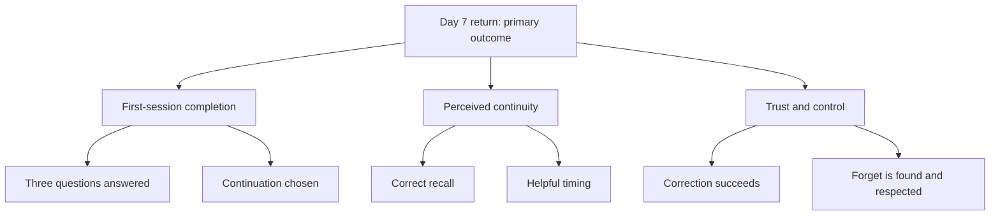

# Metrics tree

## North-star question

Does user-controlled first-session memory create a reason to return without reducing comfort or trust?

Arrows express proposed drivers, not proven causal relationships.

| Metric | Definition | Available here? |
|---|---|---|
| Day 7 return | Eligible assigned users with a qualifying return during the day-seven window / all eligible assigned users. | No. The chart is synthetic. |
| First-session completion | Assigned users reaching the intended completion point / all assigned users. | Local completion event only; no real cohort denominator. |
| Answer completion | Sessions answering all three questions / started sessions. | Observable in the local event sequence. |
| Review completion | Treatment sessions deciding all three details / treatment sessions shown the review. | Local event only. |
| Time to completion | Completion time minus session-start time. | Local timestamps; no population estimate. |
| Memory confidence | Voluntary post-session rating of correct, comfortable recall. | Not collected. |
| Incorrect recall | Sessions with a verified incorrect use of a retained detail / evaluated sessions. | Deterministic checks only. |
| Unwanted familiarity | Sessions reporting uncomfortable personalisation / surveyed sessions. | Not collected. |
| Forget integrity | Forgotten details reused after the action / evaluated forget actions. | Scripted next-reply checks only. |

## Event contract

- `session_started`: condition and initial message count.
- `question_shown`: question number and message count.
- `answer_submitted`: field name and message position; no answer value.
- `memory_review_shown`: message eight and three items.
- `control_next_step_shown`: message eight and zero items.
- `memory_kept`, `memory_edited`, `memory_forgotten`: field name only.
- `memory_review_completed`: retained count.
- `session_completed`: ten messages and retained count.
- `view_changed`: selected view.

Every event also includes a local timestamp. No event is transmitted or persisted. Restart logs a new session; it does not clear earlier events. Clear log removes the visible event history.

## Measurement caveats

The ten-message count includes Nova's scripted messages and four user choices. It is a demo milestone, not proof of meaningful engagement. A live implementation needs stable consented assignment, deduplication and a real return event. Do not reconstruct forgotten details from event data.
